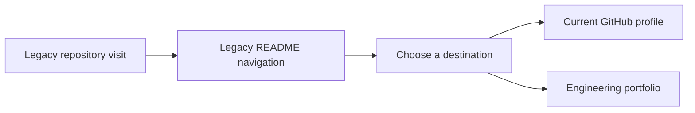

# Klokesh960

Legacy entry point for [Lokesh Reddy’s GitHub profile](https://github.com/Klokesh493) and [engineering portfolio](https://klokesh493.github.io/lokesh-kalluru-portfolio/).

## Business problem

Visitors arriving through the legacy repository need a clear link to the current profile and portfolio.

## What I built

I use this legacy landing repository to keep a direct route to my current GitHub profile and engineering portfolio. The README links directly to both destinations using Markdown, with GitHub handling rendering.

## Project walkthrough

[Architecture and data flow](docs/ARCHITECTURE.md) · [Business problem, demo, and verification](docs/CASE_STUDY.md)

## Run the project

Open this repository and follow its link to the current GitHub profile.

Read the [architecture](docs/ARCHITECTURE.md) and [walkthrough](docs/CASE_STUDY.md) for the source path and verification scope.

[Development and review](docs/DEVELOPMENT.md)

## Runbook

[Run, verify, and troubleshoot this project](docs/RUNBOOK.md)
