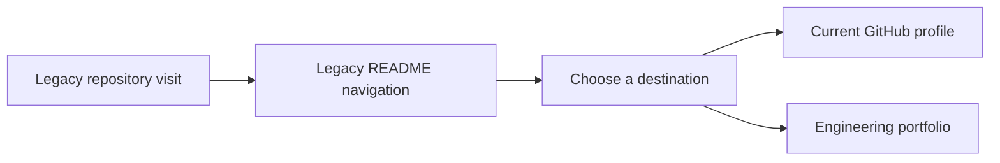

# Klokesh960 architecture

Preserve the older GitHub landing repository and direct visitors to the current portfolio.

## Operational boundaries

This repository is a navigation page. Its deliverable is the link from the legacy entry point.
